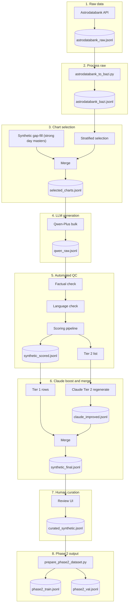

# Phase 2 Data Curation Plan

Based on [docs/phase2_data_detailed_plan_FINAL.docx](docs/phase2_data_detailed_plan_FINAL.docx) and the existing Phase 2 pipeline ([docs/phase2_implementation.md](docs/phase2_implementation.md), [scripts/prepare_phase2_dataset.py](scripts/prepare_phase2_dataset.py), [bazi_model/data/phase2_dataset.py](bazi_model/data/phase2_dataset.py)).

**Goal:** Produce 2,000–3,000 high-quality chart + interpretation examples (curated JSONL) that feed into `prepare_phase2_dataset.py` → `phase2_train.jsonl` / `phase2_val.jsonl` for BaziLLM training.

---

## 1. Data flow (high level)

---

## 2. Source 1: Astrodatabank (grounding + temporal validation)

**Target:** 500–1,000 examples with real birth data and life events for 流年/流月 (downstream we sample/filter from the full set).

**Current state (scraping done):** `data/astrodatabank_raw.jsonl` exists with **~57k records**. Schema: `name`, `date`, `time`, `longitude`, `latitude`, `location`, `rodden_rating`, `category`, `biography`, `source`, `source_url`. Dates are "DD Month YYYY", time "HH:MM" or "HH:MM:SS" (local). Rodden: ~43k AA, ~14.5k A.

**Biography length distribution:** median 526 chars; 90% >= 200 chars; 63% >= 400 chars; 30% >= 800 chars. Longer bios yield more life events and are higher-value for temporal (流年/流月) grounding.

**Decisions:**

- **to_bazi (2.1.2):** Run on all 57k (no API cost, already done).
- **Exclude:** Remove 20 records with no birth time (unreliable hour pillar).
- **Event extraction (2.1.3):** Filter to bio >= 400 chars (~36k charts) to save Qwen cost and focus on bios that can actually yield events.
- **Chart selection (section 3):** Priority order: (1) AA over A Rodden rating, (2) longer biography, (3) strength diversity. When excluding to reach target count, drop A-rated and shortest-bio charts first.

**Tasks:**

| Task      | Description                                                                                                                                                                                                                                                                                                                                                                                                                                                                        | Deliverable                       |
| --------- | ---------------------------------------------------------------------------------------------------------------------------------------------------------------------------------------------------------------------------------------------------------------------------------------------------------------------------------------------------------------------------------------------------------------------------------------------------------------------------------- | --------------------------------- |
| **2.1.1** | **Done.** Raw data produced via [scripts/astrodatabank_api.py](scripts/astrodatabank_api.py); `data/astrodatabank_raw.jsonl` (~57k records).                                                                                                                                                                                                                                                                                                                                       | `astrodatabank_raw.jsonl`         |
| **2.1.2** | **True solar time + BaziChart:** [scripts/astrodatabank_to_bazi.py](scripts/astrodatabank_to_bazi.py) reads raw JSONL; for each row: resolve timezone from (lat, lon), localize birth datetime, convert to true solar with [bazi_engine.solar_time.to_true_solar_time](bazi_engine/solar_time.py), build BaziChart. Writes `{chart: BaziChart.to_json(), name, biography, ...}`.                                                                                                   | `data/astrodatabank_bazi.jsonl`   |
| **2.1.3** | **Life events (run AFTER chart selection 2.2.1):** Script [scripts/astrodatabank_extract_events.py](scripts/astrodatabank_extract_events.py) extracts events from biography using **Qwen** (Dashscope). **Input:** `selected_charts.jsonl` filtered to bio >= 400 chars (saves API cost vs running on all 57k). Resumable and rate-limited; optional `--max_records` cap. Optionally map events to 流年 and produce 流年/流月 examples with `temporal_context` and `cross_interactions`. | `data/astrodatabank_events.jsonl` |

**Critical:** For 流年/流月, each example must have chart with `dynamic` (i.e. `temporal_context` and `cross_interactions`) so that [Phase2ChartDataset](bazi_model/data/phase2_dataset.py) and `to_input_features("cross_temporal")` succeed. Use [bazi_engine/**main**.py](bazi_engine/__main__.py) / calculator pattern to compute 大运/流年/流月 and `detect_cross_interactions`, then attach to chart JSON.

---

## 3. Chart selection: Astrodatabank primary + targeted synthetic gap-fill

**Strategy change:** Use Astrodatabank (~57k charts in `astrodatabank_bazi.jsonl`) as the primary chart source. Day master, month branch, interactions, and useful god are already well-distributed. Generate synthetic charts **only** to fill the one significant gap: **strong day masters**.

**Astrodatabank distribution (from ~57k):**

- Day master: ~10% each (nearly perfect uniform)
- Month branch: 7.6–8.9% each (acceptable)
- Interactions: all types well represented (punishments 55%, harms 41%, destructions 41%, etc.)
- Useful god: 5 categories with reasonable spread (財 21%, 比劫 19%, 食伤 18%, 官杀 14%, 印 8%)

**The gap — day master strength:**

- Very strong (>=0.80): **9** charts (0.02%)
- Strong (0.65–0.80): **248** charts (0.4%)
- Mid-strong (0.50–0.65): 3,348 (5.9%)
- Weak + very weak: 38,716 (67.8%)

Without filling this gap, the model would rarely see strong day-master interpretations during training.

**Tasks:**

| Task       | Description                                                                                                                                                                                                                                                                                                                                                                                                                                                                                 | Deliverable                                                                   |
| ---------- | ------------------------------------------------------------------------------------------------------------------------------------------------------------------------------------------------------------------------------------------------------------------------------------------------------------------------------------------------------------------------------------------------------------------------------------------------------------------------------------------- | ----------------------------------------------------------------------------- |
| **2.2.1**  | **Stratified selection from Astrodatabank:** Script that selects ~8k–9k charts from `astrodatabank_bazi.jsonl`. **Exclusions:** remove records with no birth time (20). **Priority:** AA Rodden rating first, then longer biography, then strength diversity (all strong charts included, oversample mid-strong). Ensure all day masters, month branches, and interaction types represented. When trimming to target, drop A-rated shortest-bio charts first. Output: selected chart JSONL. | `data/selected_charts.jsonl`                                                  |
| **2.2.1b** | **Targeted synthetic gap-fill:** Generate ~1k–2k synthetic charts with **acceptance sampling biased toward strong day masters** (strength >= 0.50). Use existing [scripts/generate_training_charts.py](scripts/generate_training_charts.py) + [scripts/compute_charts.py](scripts/compute_charts.py), then filter to keep only strong/mid-strong charts. Merge with selected Astrodatabank charts.                                                                                          | `data/synthetic_strong_charts.jsonl` merged into `data/selected_charts.jsonl` |
| **2.2.2**  | Distribution report on the merged `selected_charts.jsonl` to confirm balance before interpretation generation.                                                                                                                                                                                                                                                                                                                                                                              | stdout report or `reports/chart_selection_distribution.txt`                   |

---

## 4. Source 3: LLM interpretation generation (Qwen + Claude)

**Target:** ~7,500 Qwen-Plus interpretations; ~1,000 Tier 2 regenerated with Claude; task mix 本命分析 40%, 流年 30%, 流月 10%, 八字问答 20%.

**Existing:** No batch generation script in repo. Doc specifies prompt design (system + chart features + classical excerpts + output format), two-tier output (命理分析 + 实用建议), and Qwen-Plus as primary, Claude 3.5 Sonnet for Tier 2.

**Tasks:**

| Task      | Description                                                                                                                                                                                                                                                                                                                                                                                                                                                                                                                                                                      | Deliverable                                                            |
| --------- | -------------------------------------------------------------------------------------------------------------------------------------------------------------------------------------------------------------------------------------------------------------------------------------------------------------------------------------------------------------------------------------------------------------------------------------------------------------------------------------------------------------------------------------------------------------------------------- | ---------------------------------------------------------------------- |
| **2.2.3** | **Prompt builder:** Module/script that, given a BaziChart (and optional temporal context), builds: (1) chart feature text (pillars, ten_gods, elemental strength, interactions, useful god); (2) optional classical excerpts (stub or retrieval); (3) per-task prompts (本命分析, 流年, 流月, 八字问答). Output format: JSON with `reasoning` and `interpretation` (and optionally 命理分析/实用建议). Align names with Phase 2: `query`, `reasoning`, `output` (doc uses both “interpretation” and “output”; [phase2_implementation.md](docs/phase2_implementation.md) uses `reasoning`, `output`). | e.g. `scripts/phase2_prompts.py` or under `scripts/`                   |
| **2.2.4** | **Qwen-Plus bulk:** Script that reads `selected_charts.jsonl` (Astrodatabank + synthetic gap-fill), calls Qwen-Plus (Dashscope) per chart/task with rate limiting, parses JSON response into `reasoning` + `output`, writes one record per (chart, task_type) with `chart`, `task_type`, `query`, `reasoning`, `output`. For 流年/流月, chart must already carry `temporal_context` and `cross_interactions`.                                                                                                                                                                        | `data/qwen_raw.jsonl`                                                  |
| **2.2.5** | **Claude Tier 2 boost:** After QC (below), script that takes Tier 2 examples (60–79 score), regenerates interpretation with Claude 3.5 Sonnet, and replaces reasoning/output. Merge back with Tier 1.                                                                                                                                                                                                                                                                                                                                                                            | `data/claude_improved.jsonl` and combined `data/synthetic_final.jsonl` |

**Schema alignment:** Each generated line must match what [prepare_phase2_dataset.py](scripts/prepare_phase2_dataset.py) expects: `chart` (full BaziChart JSON), `task_type` ∈ {本命分析, 流年, 流月, 八字问答}, `query`, `reasoning`, `output`. For 流年/流月, `chart` must include `dynamic` (temporal_context + cross_interactions) so validation passes.

---

## 5. Automated quality control (QC)

**Target:** Factual consistency (ten-god, strength, interactions, useful god) and language quality (length, generic phrases, classical terms); tier score 80+ = Tier 1, 60–79 = Tier 2, <60 = Tier 3.

**Tasks:**

| Task      | Description                                                                                                                                                                                                                                                                                                                                                    | Deliverable                                                                |
| --------- | -------------------------------------------------------------------------------------------------------------------------------------------------------------------------------------------------------------------------------------------------------------------------------------------------------------------------------------------------------------- | -------------------------------------------------------------------------- |
| **2.3.1** | **Factual checks:** Script that, for each record, parses `chart` → BaziChart, extracts ten-god/strength/interaction/useful-god claims from `reasoning` + `output` (regex or LLM), and flags mismatches (phantom ten-god, 身强/身弱 vs `day_master_strength`, mentioned interactions not in chart, useful god mismatch). Add a `factual_issues` (or similar) field. | `scripts/factual_check.py`                                                 |
| **2.3.2** | **Language quality:** Script that checks length (e.g. interpretation ≥200 chars, reasoning ≥100), generic phrase count, presence of classical terms (用神, 十神, 刑冲合害, etc.), simple repetition heuristic. Add `language_issues`.                                                                                                                                  | `scripts/language_quality_check.py`                                        |
| **2.3.3** | **Scoring and tiers:** Combine checks into one pipeline: start at 100, deduct per factual/language issue, assign tier (1: ≥80, 2: 60–79, 3: <60). Write scored JSONL (e.g. `data/synthetic_scored.jsonl`) and summary stats.                                                                                                                                   | `scripts/phase2_quality_filter.py` or equivalent; `synthetic_scored.jsonl` |

---

## 6. Human curation

**Target:** Review Tier 1 (spot-check) and Tier 2 (full review); accept ~2,000–3,000 into final curated set.

**Tasks:**

| Task      | Description                                                                                                                                                                                                                                                                                                               | Deliverable                                         |
| --------- | ------------------------------------------------------------------------------------------------------------------------------------------------------------------------------------------------------------------------------------------------------------------------------------------------------------------------- | --------------------------------------------------- |
| **2.4.1** | **Curation UI:** Simple web app (e.g. Flask) that loads scored JSONL, shows one example at a time (chart, reasoning, interpretation, score, issues), and records action: accept / reject / flag. Persist `human_review: { rating, notes }` and index.                                                                     | `scripts/curation_app/` or single script + template |
| **2.4.2** | **Process and export:** Define review workflow (e.g. spot-check 500 Tier 1; full review Tier 2). Export only accepted rows to `data/curated_synthetic.jsonl` in the exact schema required by `prepare_phase2_dataset.py` (chart, task_type, query, reasoning, output). Optionally keep `data/flagged_for_revision.jsonl`. | `curated_synthetic.jsonl`; optional curation stats  |

---

## 7. Classical text corpus (RAG – optional for training data curation)

**Target:** 4 classical texts, chunked (~300 tokens), for retrieval at inference time; not required to produce the 2k–3k curated examples.

**Tasks:**

| Task      | Description                                                                                                         | Deliverable                                                  |
| --------- | ------------------------------------------------------------------------------------------------------------------- | ------------------------------------------------------------ |
| **2.5.1** | Acquire and preprocess: 《滴天髓》, 《子平真诠》, 《穷通宝鉴》, 《三命通会》(excerpts). Clean and chunk by section.                        | `data/classical_texts/*.txt`                                 |
| **2.5.2** | Chunking + embedding: ~300 tokens per chunk, 50-token overlap; embed with e.g. BGE; build FAISS index and metadata. | `data/classical_faiss.index`, `data/classical_metadata.json` |

This block can be done in parallel or after the main curation pipeline; it does not change the contents of `curated_synthetic.jsonl`.

---

## 8. Final assembly and Phase 2 input

**Target:** Single curated file + train/val split matching existing pipeline.

**Tasks:**

| Task      | Description                                                                                                                                                                                                                                                                                                                                                                           | Deliverable                                                                                  |
| --------- | ------------------------------------------------------------------------------------------------------------------------------------------------------------------------------------------------------------------------------------------------------------------------------------------------------------------------------------------------------------------------------------- | -------------------------------------------------------------------------------------------- |
| **2.6.1** | **Schema and validation:** Ensure `curated_synthetic.jsonl` (and any Astrodatabank-derived rows merged in) conform to: `chart` (BaziChart JSON with optional `dynamic`), `task_type`, `query`, `reasoning`, `output`. Add validation script that runs the same checks as `prepare_phase2_dataset._validate_record` and reports errors.                                                | `schemas/training_example.json` (optional JSON Schema); `scripts/validate_curated_phase2.py` |
| **2.6.2** | **Merge and split:** If Astrodatabank examples are produced in the same schema, merge with curated synthetic; then run [scripts/prepare_phase2_dataset.py](scripts/prepare_phase2_dataset.py) with `--input data/curated_synthetic.jsonl` to get `data/phase2_train.jsonl` and `data/phase2_val.jsonl`. Optionally add test split (e.g. 80/10/10) in the prepare script or a wrapper. | `phase2_train.jsonl`, `phase2_val.jsonl` (and optionally `phase2_test.jsonl`)                |

**Completion criteria (from doc):** 2,000–3,000 curated examples; 200–300 val (and optionally test); all records valid for Phase2ChartDataset; automated QC and curation docs in place.

---

## 9. Implementation order and dependencies

1. **Astrodatabank raw + bazi:** 2.1.1 (raw, done) → 2.1.2 (true solar + BaziChart, done).
2. **Chart selection:** 2.2.1 (stratified selection from astrodatabank_bazi, exclude no-time, prioritize AA + long bio) → 2.2.1b (synthetic gap-fill for strong day masters) → 2.2.2 (distribution report).
3. **Event extraction:** 2.1.3 (Qwen event extraction on selected charts with bio >= 400 — run AFTER chart selection to minimize API cost).
4. **Prompts + generation:** 2.2.3 (prompt builder) → 2.2.4 (Qwen bulk interpretation generation).
5. **QC:** 2.3.1 + 2.3.2 → 2.3.3 (scoring pipeline) on `qwen_raw.jsonl`.
6. **Claude boost:** After 2.3.3, 2.2.5 (regenerate Tier 2) → merge into `synthetic_final.jsonl`.
7. **Curation:** 2.4.1 (UI) → 2.4.2 (export `curated_synthetic.jsonl`).
8. **Assembly:** 2.6.1 (validation) → 2.6.2 (prepare_phase2_dataset).
9. **Optional:** 2.5.x (classical RAG) in parallel or later.

---

## 10. Key files and contracts

- **Curated input:** [docs/phase2_implementation.md](docs/phase2_implementation.md) § Curated input format: `chart`, `task_type`, `query`, `reasoning`, `output`; for 流年/流月, chart must have `temporal_context` and `cross_interactions` (via `dynamic` in BaziChart JSON).
- **Prepare script:** [scripts/prepare_phase2_dataset.py](scripts/prepare_phase2_dataset.py): reads curated JSONL, validates, adds `task_token`, `input_sequence`, `target_sequence`, stratified train/val split.
- **Dataset:** [bazi_model/data/phase2_dataset.py](bazi_model/data/phase2_dataset.py): expects `phase2_*.jsonl` with same fields; 流年/流月 need `_dynamic_from_chart(chart)` non-None (i.e. chart has `temporal_context` and `cross_interactions`).
- **True solar time:** [bazi_engine/solar_time.to_true_solar_time](bazi_engine/solar_time.py); [bazi_engine/calculator.py](bazi_engine/calculator.py) uses it when lat/lng provided.
- **Task types and distribution:** [bazi_model/data/phase2_dataset.py](bazi_model/data/phase2_dataset.py) and prepare script: `TASK_TYPES`, `TARGET_DISTRIBUTION` (本命分析 40%, 流年 30%, 流月 10%, 八字问答 20%).

---

## 11. Risks and mitigations (from doc)

- **Generic outputs:** Improve prompts (few-shot, length/terminology constraints); consider Claude for Tier 2.
- **Over-aggressive QC:** Calibrate thresholds; spot-check Tier 3; document scoring.
- **Astrodatabank time errors:** Validate 10+ known charts with another calculator; document conversion (timezone → solar time) and test DST edges.
- **Slow curation:** Prioritize Tier 1; review only Tier 2 with fewer issues; consider second reviewer.

